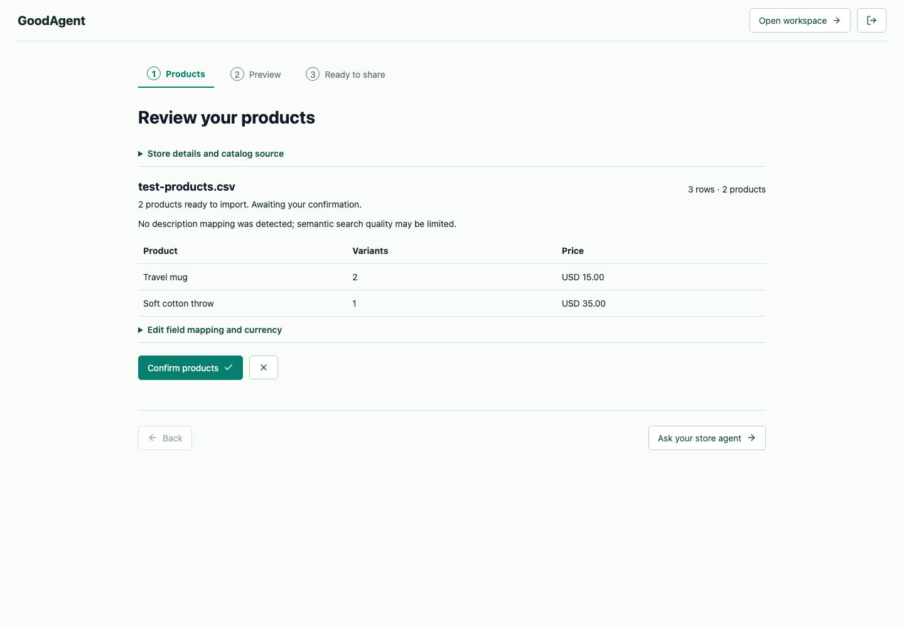
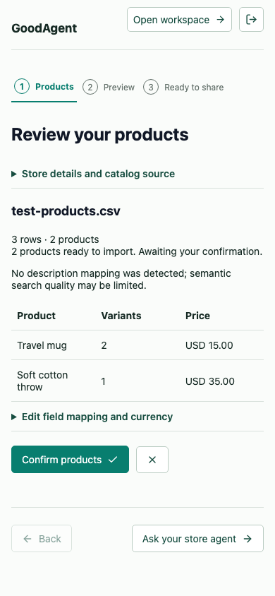
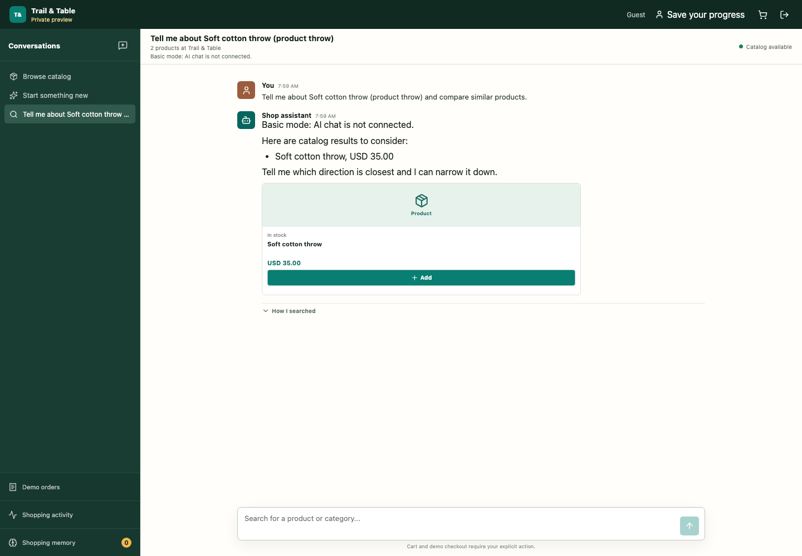
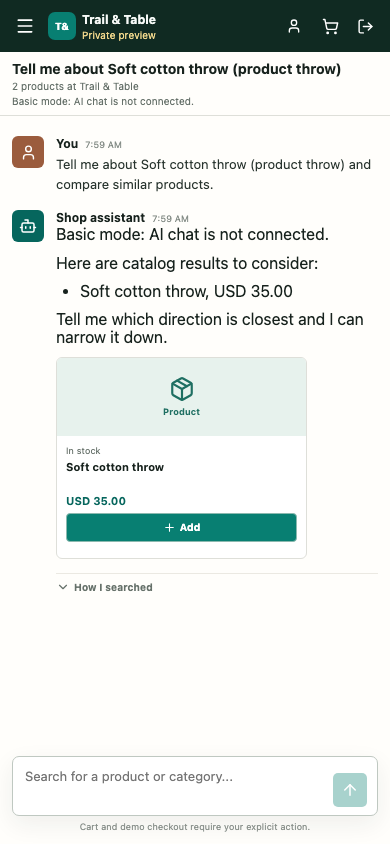

# Current Interface Screenshots

These are unedited GoodAgent screenshots of a disposable synthetic store,
captured during the passing owner-to-shopper browser test on October 18, 2026,
11:59-12:00 UTC (7:59-8:00 AM Eastern). They show the application at that snapshot,
not design mockups or the owner's store. Release qualification remains incomplete.
The earlier branding gallery remains available below with its original identities.

The fixture has two products and three variants, invented USD prices/stock, and
no product photographs in these scenes. The placeholder is intentional. Separate
image-delivery tests attach synthetic colored markers later; those frames are not
selected for this gallery. AI is disconnected:
the shopper's Basic-mode result is not an LLM answer, a successful model comparison
or evidence of recommendation quality. No payment is taken. No bootstrap token,
password, recovery code or private browser trace appears in these selected frames.

## Owner: Review Before Import

The store owner can review rows, variants, currency and validation warnings before
confirming the import. This fixture deliberately omits descriptions, so the app
displays the resulting search-quality warning instead of silently hiding it.

Mobile catalog review, 390 by 844

## Shopper: Results And Explicit Cart Actions

A guest in a private preview receives a catalog-backed Basic-mode result. The
shopper must explicitly choose Add; conversation does not purchase anything.

Mobile shopper result, 390 by 844

## Provenance And Reproduction

[The current media manifest](assets/alpha/20261018-current/manifest.json) records the source snapshot hash,
capture window, fixture/mode, dimensions and exact SHA-256 of each image. Desktop
frames are 1440 by 1000; mobile frames are 390 by 844. Pixels are copied unchanged
from Playwright output, with no retouching, redaction, compositing or generated
answers. These frames contain the project interface and icons, not third-party
product photos; dependency notices remain in [third-party notices](../THIRD_PARTY_NOTICES.md).

The fixture is in [the self-service browser test](../apps/web/e2e/self-service.spec.ts).
Run the opt-in isolated self-service suite from the
[reproduction guide](FIRST_STORE_DEMO.md), never against an existing store.
Dates, IDs and exact screenshot bytes vary between runs. Private traces are not
published because they can contain authentication material.

The source hash identifies the tested implementation, not a public Git commit.
These screenshots do not claim a finished screen recording or final release.
[Recording status and capture instructions](ALPHA_DEMOS.md).

## Historical Gallery

The earlier October 18 01:16-01:17 UTC capture (October 17 Eastern) predates
GoodAgent branding and the later recovery/welcome changes. Its original pixels,
manifest and source identity are preserved, not silently replaced by this update.
Both galleries use separate disposable two-product fixtures and Basic mode.

- [Earlier owner desktop](assets/alpha/owner-products-desktop.png)
- [Earlier owner mobile](assets/alpha/owner-products-mobile.png)
- [Earlier shopper desktop](assets/alpha/shopper-results-desktop.png)
- [Earlier shopper mobile](assets/alpha/shopper-results-mobile.png)
- [Historical manifest](assets/alpha/manifest.json)
