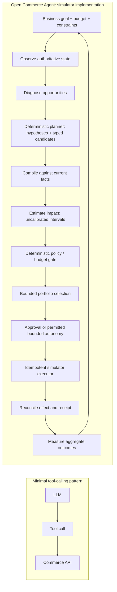
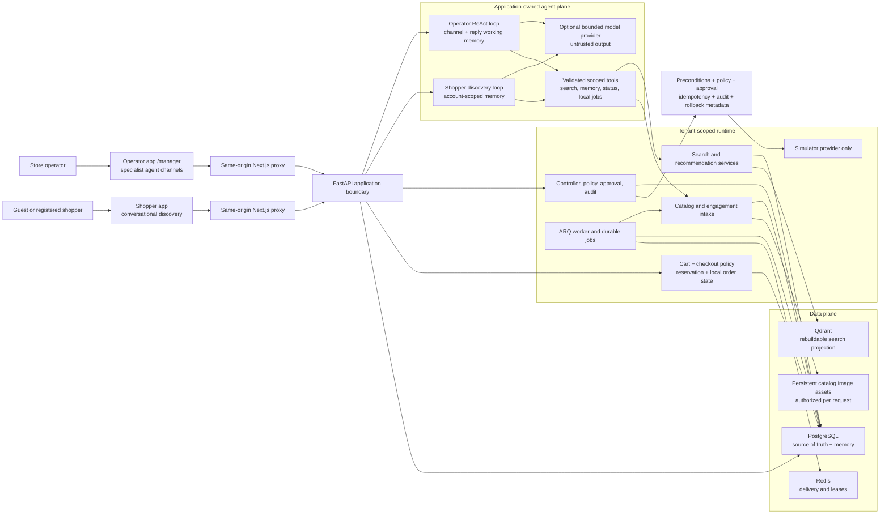
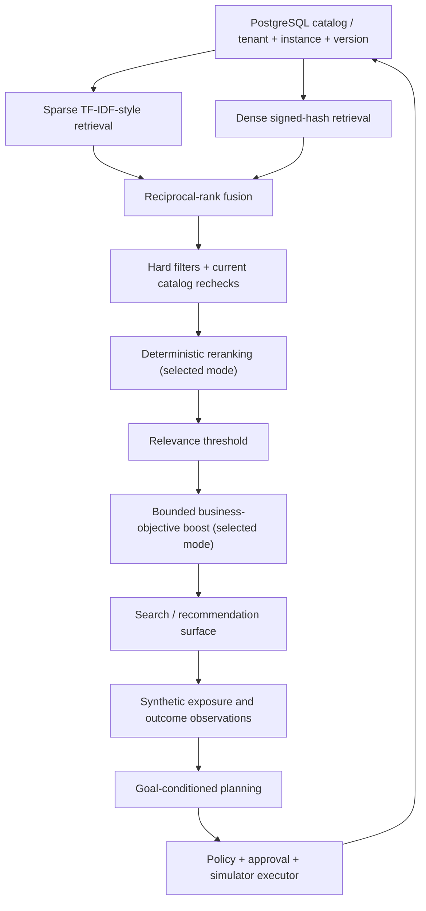

# Architecture

The [self-service store layer](SELF_SERVICE_SETUP.md) extends existing tenant/user
membership with owner sessions and OIDC, staged encrypted imports, exact-version
publication, scoped guest sessions, and shared PostgreSQL model budgets. API and
worker authorization validate persisted store ownership. Merchant and shopper
interfaces remain separate clients of the same typed backend; no shopper receives
merchant credentials or write tools. Migrations 0020-0024 preserve older records.

The current product has two conversational agents: one for the store owner and
one for shoppers. Application code owns authentication, publication, validated
tools, price arithmetic and explicit cart/checkout actions. A model never receives
store credentials or authority to make a live commerce write.

The older goal-conditioned simulator controller remains for regression work. The
controller diagrams and benchmark sections below describe that separate historical
subsystem, not automatic sales optimization in the self-hosted store. The
[deployment details](LOCAL_ARCHITECTURE.md) cover its transaction and recovery model.

## Historical Simulator Control

The left path is a minimal tool-calling pattern, not a claim about every other project.



Policy evaluates candidates **before** the current stable, risk-ordered portfolio
selector; dispatch rechecks it afterward. Portfolio selection is a bounded sort,
not a learned optimizer. Replanning uses new observations and guardrail outcomes,
not online model training. Search, promotions, price and campaign budget are
possible actuators beneath the loop, not independent agents with write authority.
Inventory is observed and gates decisions; inventory-quantity writes do not exist.

## Component Map

### Product runtime graph

The operator and shopper experiences are separate applications connected through
one tenant-scoped backend. `manager` remains in route and module names for API
compatibility; the product calls the person running the store a **store operator**.



Operator agent channels are independent conversation branches, not independent
write authorities. They share tenant onboarding and explicit long-term preferences
while retaining separate working memory, periodic summaries, drafts, scroll state,
and concurrency control. The shopper agent has separate account identity and
memory, but reads the same tenant catalog and search projection. Optional model
providers can request allowlisted tools; only application code validates and runs
those calls. Raw chain-of-thought and reasoning tokens are not product output.
The shopper discovery endpoint reads representative products from the active
catalog version, so operator uploads drive both starter prompts and catalog search.
Manager reset is deliberately narrower than tenant reset: it removes only manager
conversation/onboarding state and leaves the shared catalog, search projection,
simulator, and shopper identity data intact.

### Shopping command path

```mermaid
sequenceDiagram
  participant S as Signed-in shopper
  participant UI as Shopper UI
  participant A as Shopper search agent
  participant C as Commerce service
  participant DB as PostgreSQL
  participant P as Local test payment provider

  S->>UI: Describe a shopping need
  UI->>A: Conversational search
  A->>DB: Bounded read-only catalog query
  DB-->>A: Grounded product candidates
  A-->>UI: Recommendations and evidence
  S->>UI: Explicit Add action
  UI->>C: Add item + idempotency key
  C->>DB: Recheck catalog, price, availability; version cart
  S->>UI: Review checkout
  UI->>C: Exact cart version + idempotency key
  C->>DB: Lock, validate policy, create expiring reservations
  S->>UI: Explicit test confirmation
  UI->>C: Finite test method + idempotency key
  C->>P: Confirm typed local intent
  P-->>C: Success or controlled decline
  C->>DB: Audit transition; create at most one demo order
```

This split is deliberate: the agent helps decide what to buy, while explicit UI
commands own cart and checkout changes. The LLM cannot call the commerce service.
The server supplies identity and authoritative price/inventory facts, serializes
mutable state, and records preconditions, policy, idempotency, audit, and release
metadata. The local payment adapter exercises a provider lifecycle without card
data or real money. Inventory remains observed state; reservations are local holds,
not source quantity writes. See [Cart and checkout design](CART_CHECKOUT.md).

Paths below are under `packages/backend/src/open_commerce/`.

| Component                | Current contract and implementation                                                                                                                                                                      |
| ------------------------ | -------------------------------------------------------------------------------------------------------------------------------------------------------------------------------------------------------- |
| Goal                     | `core/goals.py`: objective metric/direction/scope/target, UTC horizon, integer-minor-unit money, budgets, constraints, allowed actions and autonomy. API creation has a finite supported vocabulary.     |
| Controller               | `controller/durable.py`, `workflow.py`: PostgreSQL-backed planning cycles; Redis/ARQ delivers recoverable jobs. Not LangGraph.                                                                           |
| Observation              | `controller/detectors.py`: catalog, inventory, campaign and metric snapshot, with version/freshness evidence.                                                                                            |
| Opportunity detection    | Same module plus `objectives.py`: goal-conditioned gaps, conservative physical infeasibility and heuristic trajectory. No guarantee of attainability.                                                    |
| Planner                  | `controller/planner.py`: deterministic baseline. Opt-in `model_planning.py` checkpoints bounded local-model investigation; `ollama.py` is its single loopback adapter. No paid provider.                 |
| Candidate compiler       | `controller/compiler.py`: validates a finite action union against authoritative targets; adds preconditions, estimated exposure, idempotency and rollback metadata.                                      |
| Impact estimation        | Compiler attaches fixed heuristic intervals and assumptions. These are predictions, not observed or calibrated causal effects.                                                                           |
| Policy engine            | `controller/policy.py`: capabilities, freshness, scope, margins, discount/price/budget bounds, autonomy and kill switch. Domain policy imports no provider SDK.                                          |
| Budget ledger            | `application/services/budget.py`, persistence budget repositories: reservations, settlement/release, total/daily caps and append-only history. Observed ad spend is not the complete reservation ledger. |
| Approval / autonomy      | `core/policy_types.py`, durable controller/executor: exact action-hash and policy-version approval; default approval-required. Shadow vetoes writes.                                                     |
| Provider executor        | `controller/durable_executor.py`: prepare, dispatch, persist effect/receipt, reconcile/finalize. Only simulator writes are enabled.                                                                      |
| Measurement              | `controller/measurement.py`: sampled windows, missing-data states, aggregate comparison and guardrail breaches. Sufficiently sampled breaches can pause; no automatic causal credit.                     |
| Audit                    | Persistence action/audit repositories, trace records, immutable ledger/audit triggers. A privileged DB owner remains trusted.                                                                            |
| Search / recommendations | `search/durable.py`, `qdrant_index.py`: live, reconstructable Qdrant retrieval with authoritative catalog rechecks. Similar/popular recommendation API; no learned personalization.                      |
| Shopper commerce         | `commerce/service.py`: account-scoped carts, exact-version checkout previews, local reservations, deterministic test payment, demo orders and operator read visibility. No live payment or source inventory write. |
| Simulator                | `simulator/`: seeded catalog, demand, campaigns, discounts, exposures, virtual clock and durable receipts. Engine-only golden tests are not durability tests.                                            |
| Provider abstraction     | `core/providers.py`: typed commerce, ads, behavioral-event and virtual-clock protocols; only simulator adapters execute today.                                                                           |

## Trust Boundary

| System                           | Authority                                                                                                                                                                                |
| -------------------------------- | ---------------------------------------------------------------------------------------------------------------------------------------------------------------------------------------- |
| Local LLM (experimental, opt-in) | May request finite read-only evidence or propose untrusted typed actions. Never grants permission or executes writes. Current development evidence does not demonstrate useful planning. |
| ML / statistics / search         | Catalog retrieval uses configured bounded providers. Engagement uploads can train popularity/logistic-regression candidates; approval is separate from training, and neither proves business lift. |
| Deterministic policy engine      | Decides permission, budget and constraints from authoritative facts. Rechecked at dispatch.                                                                                              |
| Provider executor                | Performs a compiled action only after all gates, with durable idempotency, audit, preconditions and rollback metadata.                                                                   |
| PostgreSQL                       | Authoritative goals, policy, approvals, effects/receipts, budgets, measurements, audit and simulator state.                                                                              |
| Redis / Qdrant                   | Delivery and search projections. Neither owns business truth.                                                                                                                            |

The browser is a view of recorded facts, not an enforcement authority. A green
proposal policy is not execution; approval is not reconciliation; reconciliation
is not evidence of business improvement. The UI separates all of these records.

Model mode has independent request/token reservations, immutable settled inference
records, goal revisions and observation checks. The default Compose deployment
does not ship a model daemon. The tested external-to-the-repo local daemon has
unresolved security findings; additional live validation is blocked. See
[model scope](MODEL_PLANNING.md) and [security review](MODEL_PLANNING_SECURITY.md).

## Search As An Actuator



Tenant/catalog filters are also pushed into retrieval; the diagram emphasizes
the post-retrieval checks, not a single late filter. A high-margin overstocked
product cannot buy relevance. A boost needs matching query/category, available
stock, qualifying variants/prices, relevance evidence and a bounded multiplier.
Denied/expired actions do not become durable search rules.

Dense vectors are signed hashing, sparse scores are term-frequency/IDF style
(not full BM25), reranking is deterministic, and no neural personalization is
claimed. Live Qdrant serves the API; simulator demand also has a deterministic
in-process exposure model. Those are related rules, not proof that every virtual
purchase traverses the network Qdrant query path. [All measured modes](BENCHMARKS.md)
include reranking that did not improve NDCG.

## Deployment And Recovery

Browser -> same-origin Next.js proxy -> FastAPI -> PostgreSQL.
The worker reloads durable IDs through ARQ; leased jobs can be rediscovered after
Redis loss. Qdrant is rebuilt from the versioned authoritative catalog. Simulator
effect and receipt can share a PostgreSQL transaction; a future remote store
cannot inherit that atomicity by implementing the same interface.

Use non-sensitive data on a trusted workstation while this alpha is unqualified.
The default self-hosted store requires authenticated owner membership; guest and
preview sessions cannot access owner APIs. The explicit historical `legacy_demo`
profile uses fixed identity and is **not authentication**. [Threat model](THREAT_MODEL.md),
[extension guide](EXTENDING.md), [implemented versus planned](ROADMAP.md).
